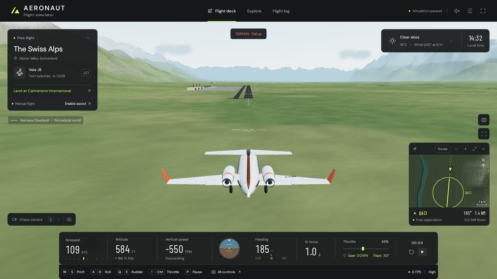
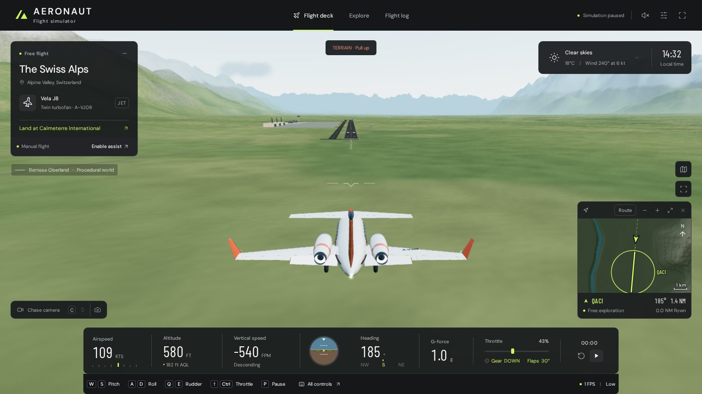
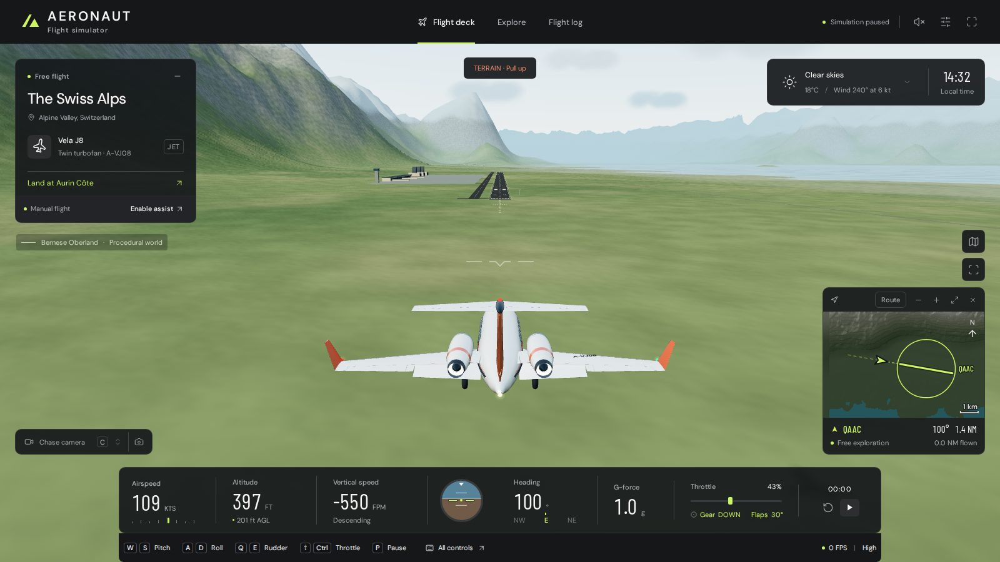
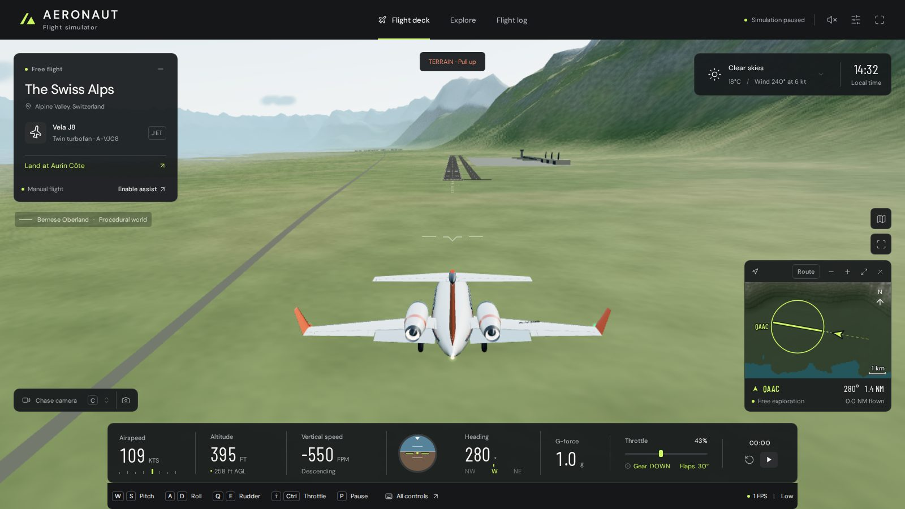
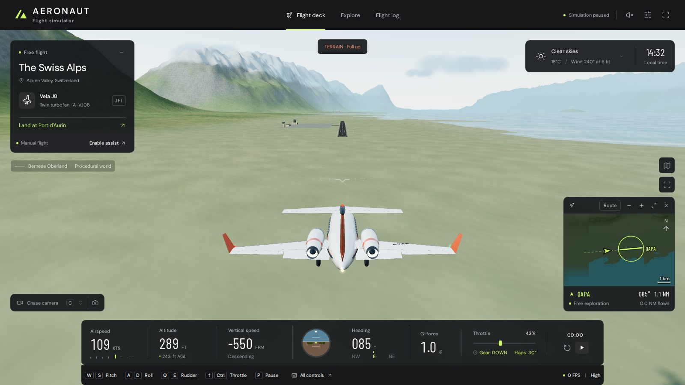
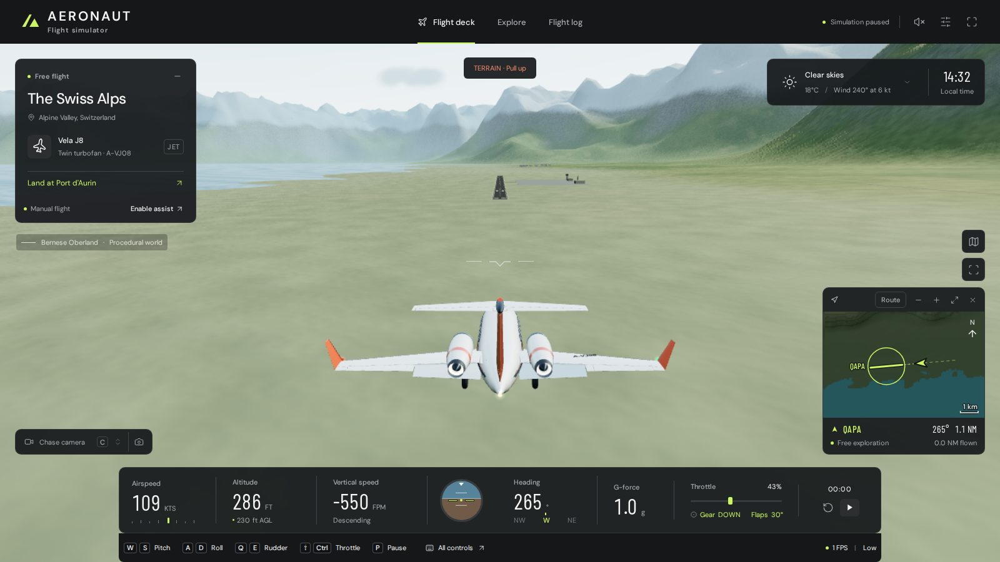
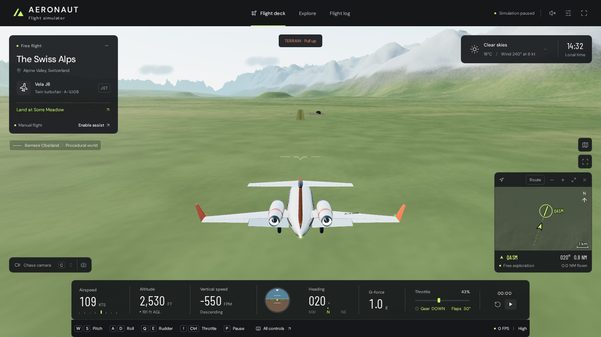
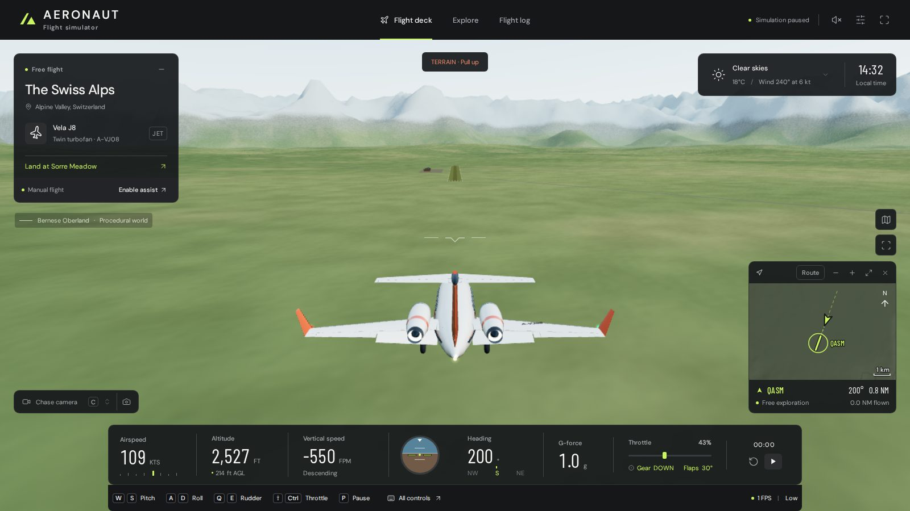
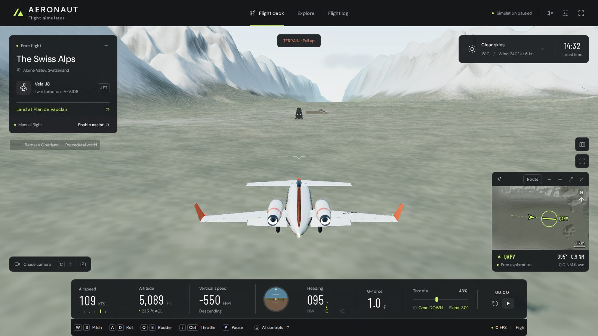
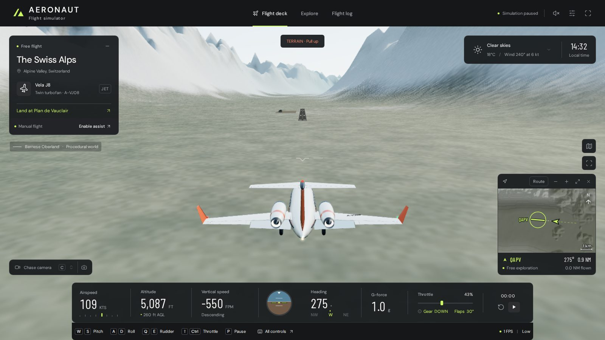

# Airport expansion: ten fields

Five airports are built on the sites surveyed beyond the Divide (docs/world-scale.md), taking the catalog from five to ten. The five original fields are unchanged: same ids, idents, positions, elevations, runways, grading and scenery (tested). No dependencies, palette or new UI patterns were added, and no teleport controls: departures and missions start from the Explore and mission actions as before.

| Field (`id`) | Ident | Region | Runways | Runway | Elevation | Kind | Lit |
| --- | --- | --- | --- | --- | --- | --- | --- |
| Calmeterre International (`calmeterre-international`) | QACI | Calmeterre | 01 / 19 | 3,200 × 45 m asphalt | 110 m | commercial | yes |
| Aurin Côte (`aurin-cote`) | QAAC | Aurin Coast | 10 / 28 | 3,000 × 45 m asphalt | 53 m | commercial | yes |
| Port d'Aurin (`port-aurin`) | QAPA | Aurin Coast | 09 / 27 | 1,800 × 30 m asphalt | 20 m | regional, lakeside | yes |
| Sorre Meadow (`sorre-meadow`) | QASM | Cendre Highlands | 02 / 20 | 900 × 30 m grass | 703 m | grass | no |
| Plan de Vauclair (`vauclair-altiport`) | QAPV | Vauclair Glaciers | 10 / 28 | 1,200 × 30 m asphalt | 1,483 m | mountain | yes |

## How it is built

- **Registry** (`src/airports.js`): each entry is made from its `AIRPORT_SITES` record (`surveyed(id, …)`), so position, elevation, heading, runway, surface and apron are exactly the survey's; the registry adds the ident, lighting, summary and caution. Ids match the site ids. Designators and both thresholds match the published survey table.
- **Terrain**: the fields join `GRADED_AIRPORTS`, so `groundHeight` and its GLSL twin grade each one with the same rectangle (footprint + 250 m flat, 700 m / 300 m blend). The CPU and GLSL heights agree to 1e-6 m over every field's whole grading box, both 8 km approaches and 150 m either side.
- **Scenery** (`src/world.js` `networkField`): the existing field builder, with runway paint (12 threshold bars, touchdown-zone and aiming-point marks on the 45 m runways), edge lights, apron, taxi links, windsock and buildings, batched by material. A new `commercial` kind adds a 520 m glazed terminal with three gate piers, a 44 m tower, three arched hangars, a full-length parallel taxiway with its centreline and three links, and 300 m of approach lights beyond each threshold (kept inside the flat graded ground). Port d'Aurin uses the lakeside buildings, Sorre Meadow the timber barns and mown lanes, Plan de Vauclair the stone hut and hangar.
- **Clearance**: trees, houses and roads keep off the new fields through the same `nearAirport`/`inProtectedArea`/`onAirfield` tests as the other network fields; a site that has been built is no longer tested separately as a site.
- **Efficiency**: each field is a handful of merged meshes. Network fields are now drawn only within `AIRPORT_RANGE` of the camera (40 / 30 / 22 km at high / medium / low quality); Alpine Field is always drawn. In the browser checks below the renderer stayed at 116–182 draw calls.

## Suitability and missions

`suitability` and `RUNWAY_NEEDS` are unchanged. The two long fields suit all 17 aircraft. Port d'Aurin takes the 737 but is too narrow for the widebody (needs a runway 45 m wide). Sorre Meadow is grass: every paved-only type is refused, and the cargo transport needs 1,000 m. Plan de Vauclair takes the 737 as a tight fit and refuses the widebody.

A refused mission now lists the fields that suit the aircraft **nearest first** (`missionAvailability().alternatives`), and the brief offers the three nearest as buttons, so the list stays short with ten fields. Missions, retry and cancel use the existing `LandingMission`: a retry keeps the mission's own field and runway even after the selection changes, and cancelling returns navigation to the selected field.

## Interface

The Explore **Airfield** list and the chart's **Destination** list are bounded scroll lists, like the aircraft roster (300 px in Explore, 260 px on phones; 262 px on the chart), and scroll just far enough to show the chosen row when they open or change. They keep the roster's radio rows, arrow/Home/End keys and focus rings. At 1280 × 800 the chart dialog now fits without scrolling (it scrolled 264 px with ten rows before the cap).

## Tests

`tests/new-airports.test.js` (added to `npm test`), plus the existing network, selection and world-scale tests, now over ten fields:

- registry: survey fidelity, idents, designators and published thresholds; the original five unchanged;
- grading: flat box exact, CPU/GLSL agreement over box, blend and both approaches, dry footprint; the original suite's flatness, mesh and bank checks on every field;
- approaches: on both runways a 3° path is 30 m clear of the centreline ground from 800 m to 8 km and 15 m clear 75 m either side out to 4 km;
- trees and villages off each field and its approach funnel;
- suitability and refusal reasons, with alternatives sorted by distance;
- full simulated missions in **both directions** with the landing tests' feedback pilot: widebody at Calmeterre, 737 at Aurin Côte, Orsino R70 at Port d'Aurin, Alba B2 at Sorre Meadow, Veyra U9 and Laret H4 at Plan de Vauclair; and (existing suite) a trainer departure and landing on every runway of every field;
- selection: every field and runway selected, saved through `saveSettings`/`loadSettings` and restored; mission retry keeps its field, cancel restores the selection as the destination.

`npm test`: 360 pass. `npm run build` succeeds.

## Browser review (software WebGL in this VM)

Each field was flown from the existing *approach* start (and QACI also from a runway departure) on both runway directions, at high and low quality; every start was clear of the ground and not crashed, on the right heading and over the right threshold. Screenshots (one per direction, alternating quality):

| Field | Runway, quality | |
| --- | --- | --- |
| Calmeterre International | 01 high (on the runway), 19 high, 19 low |    |
| Aurin Côte | 10 high, 28 low |   |
| Port d'Aurin | 09 high, 27 low |   |
| Sorre Meadow | 02 high, 20 low |   |
| Plan de Vauclair | 10 high, 28 low |   |

Interface: [Explore at 1600 × 900](airport-expansion/explore-1600.jpg), [Explore at 390 × 844](airport-expansion/explore-390.jpg), [refused widebody mission at Sorre Meadow, 1280 × 800](airport-expansion/mission-refused-1280.jpg) (offers Alpine Field, Aurin Côte and Orvane Regional), [chart at 1280 × 800](airport-expansion/chart-1280.jpg), [chart at 390 × 844](airport-expansion/chart-390.jpg). In the app: a widebody mission started from the refusal's *Land at Aurin Côte instead*, then the selection moved to Port d'Aurin 09; *Retry* restarted at Aurin Côte 10, and *Cancel* returned the destination to Port d'Aurin 09. After a reload the selection (Port d'Aurin 09) was restored from storage.

## Limitations

- **Aurin Côte runway 10**: the Divide's flank reaches within 300 m north of the extended centreline 4–5 km out and stands above a 3° path there (the centreline itself stays 48 m clear). Lowering it would carve a 270 m cutting into the mountainside, so the terrain is kept and the field's caution tells pilots to join the final from the sea, inside 4 km, and keep right of the centreline. A scored mission starts 1.1 km out, clear of it.
- The approach start used for these screenshots sounds *TERRAIN · Pull up* on a free-flight final at every field, as it does at the original fields; scored missions suppress it on their own final.
- Frame rates in the VM are software-rendered (0–1 FPS) and say nothing about real hardware; draw calls and triangle counts are the comparable measure.
- Suitability does not account for field elevation (unchanged rule); the cautions for Plan de Vauclair and Orvane Regional mention the longer roll.
