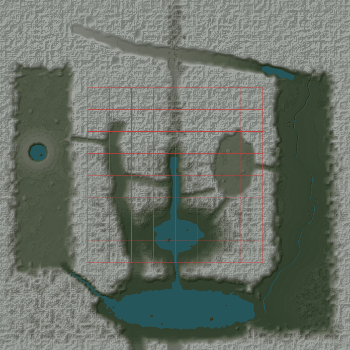

# World scale: a 140.8 km world

The world grows from 70.4 km square to **140.8 km square** (`WORLD`, ±70,400 m, 16 × 16 terrain tiles of 8.8 km): four times the area. The original world is kept bit for bit as `CORE` (±35,200 m) at the centre. Its old rim now stands as **the Divide**, a ring of ranges, and four new regions with landforms of their own lie beyond it. A new rim closes every edge in mountains. No dependencies, downloaded data, UI or palette were added. All 17 aircraft, controls, settings, warnings and missions are unchanged, and there is no teleport.

## The outer regions

| Region (`id`) | Landform | Places |
| --- | --- | --- |
| **Vauclair Glaciers** (`northern-glaciers`) | A U-shaped glacial trough: a flat floor between walls that steepen 1,400 m into the range, running from snowbound cirques at 2,150 m (the glacier floor is above the snow line) to an overdeepened finger lake at its mouth. Moraine hummocks and outwash on the floor; four cirques hollowed into the walls. | Glacier de Vauclair, Pic Blanc, Lac Long, Vauclair and a high hamlet, the Plan de Vauclair outwash floor |
| **Calmeterre** (`eastern-lowlands`) | A broad river plain (24–150 m) below the 1,000 m **Orvane Escarpment**. The Calme meanders 90 km south to the sea, and three oxbow lakes lie beside it. The floodplain steps up in three terraces to rolling farm hills, with copses scattered across them. | Calmeterre (town), Saint-Aubry, Les Prés, Lac des Saules, the Calme |
| **Aurin Coast** (`southern-coast`) | The **Mer d'Aurin**, an inland sea of over 400 km² that is 85 m deep at its heart. It has a rocky archipelago and a low coastal plain on its north shore. The **Fjord de Lisse** runs north-west from it between walls over 600 m high. The **Gorges d'Aurin** join it to Lac Serein by water through the Divide. | Mer d'Aurin, Les Écueils, Aurin (town), Lisse, two coastal villages and an island hamlet |
| **Cendre Highlands** (`western-highlands`) | A lava tableland near 760 m. The **Mont Cendre** caldera (rim 1,380 m) holds a crater lake with a young cone for an island. Four lava tongues run from its flanks, and five cinder cones stand with summit craters. The Plaine de Sorre is smooth farmland in a shallow basin. | Lac Cendre, Mont Cendre, Puy Rouge, Puy de Sorre, Cendre, Sorre, Pas de Cendre |

Routes in (`ROUTES`, `outer: true` corridors are cut after the outer ground, so they run on through it):

- **Col de Vauclair**: north from the Northern Range's high valley over a 1,780 m saddle in the Divide, down to the Vauclair trough.
- **Rampe d'Orvane**: from the Orvane Plateau (1,030 m) down the escarpment to Calmeterre (170 m).
- **Gorges d'Aurin**: open water from Lac Serein through the Divide to the Mer d'Aurin.
- **Pas de Cendre**: west from Val Verdance over a 1,050 m pass onto the Cendre tableland.
- **Fjord de Lisse**: from the Mer d'Aurin to the foot of the Cendre tableland.
- **Val Vauclair** and **The Calme** (`carve: false`): the trough floor down to Calmeterre, and the river on to the sea.

New roads follow the Rampe, Calmeterre's east terrace, Val Vauclair, the Aurin shore and the Cendre tableland. New villages (14) draw their houses from a random sequence of their own, so every original village, tree and cloud stays where it was.

## Data and terrain

- `src/regions.js`: `WORLD`, the new `CORE`, `SHAPES.divide`, `rim`, `trough`, `lowlands`, `sea` and `highlands`, the new `REGIONS`, `ROUTES`, `LANDMARKS` (24 new), `VILLAGES` (14 new) and `AIRPORT_SITES` (below). `regionAt` looks up the new regions before the `outer-ranges` catch-all.
- `src/terrain.js`: `groundHeight` and its GLSL twin `groundShader` gain `outerHeight`/`groundOuter`, line for line. Every outer weight is zero inside `CORE` and skipped there, so the original world is not just close to its old heights but identical to them (tested: 117,954 points over a 200 m grid, outside the new pass cuts). The old rim term is kept exactly up to the old edge and then fades out (the Divide). New helpers: `calmeCurve`, `lowlandEdge`, `seaDistance`.
- Water stays the one plane at `WATER_LEVEL`. Every new lake, river and fjord is ground carved below it, so the lake shader reads its true depth from the same function. `deepSea(x, z)` lets the shader skip the terrain over the Aurin's heart, where water is over 26 m deep, as `deepBasin` does for Lac Serein.

### Cost

Measured in Node on this VM:

| Function | Original world | Whole 140.8 km world |
| --- | --- | --- |
| `groundHeight`, per sample | 0.95 µs before → 1.29 µs | 2.0 µs |

The extra cost inside the original world comes from the Divide terms and the outer-corridor bounding-box tests.

## Rendering: bounded resident scenery

Only nearby scenery is held at full detail, so resident geometry, tree counts and draw calls stay bounded however large the world grows. The larger world still costs a little at the original start view: terrain now continues past the old edge, adding 10 draw calls on high quality (88 → 98) and 4 on low (71 → 75). Looking in from the old world's corner it costs 49 fewer (table below). This uses current APIs only (see the integration seam below).

- **Terrain**: every tile keeps a 26-segment mesh that has exactly the vertices of its step-4 mesh (tested). A tile is given its 104-segment mesh only when the camera comes within the step-1/step-2 range plus 2.5 km (high 22 km, balanced 16 km, low 7.5 km), and loses it again 8 km past that. Full meshes are built a few rows at a time within a 4 ms per-frame budget. Tiles within 4 km of the aircraft (after a runway start, say) are built at once. At most 64 full tiles are resident anywhere in the world, the same as the old world's total. Coarse tiles are drawn as 2 × 2 blocks (one draw each) unless a block holds a full tile. LOD steps, skirts, the one vertex grid and the one-metre near plane are unchanged.
- **Forest**: the original 28,200 trees and the regions' 52,000 keep their sequences and buckets. Each outer tile plants its own forest (up to 2,600 trees, from a per-cell seed, so the same trees every time) once the camera comes within the forest range plus 2.5 km. Planting is spread across frames, and a cell is dropped 8 km past the range. Trees keep off water, steep ground, the airports and the surveyed sites.
- **Clouds**: 40 more over the outer regions (10/20/40 by quality); clouds more than 48 km from the camera are not drawn.
- **Boats**: five more on the Mer d'Aurin, Lac Long and Lac Cendre.

Software WebGL in this VM, scene only (no aircraft or HUD), 1600 × 900:

| View | Before | After |
| --- | --- | --- |
| `createWorld()` | 2.6 s | 2.2–3.5 s |
| Start view, high | 88 draws, 411k tris | 98 draws, 527k tris (34 full tiles) |
| Start view, low | 71 draws, 124k tris | 75 draws, 251k tris (terrain now runs past the old edge) |
| Old world corner looking in, high | 205 draws, 235k tris | 156 draws, 314k tris |
| New world corner, high | n/a | 46 draws, 263k tris |
| Calmeterre / Aurin / Cendre / Vauclair, high | n/a | 37–53 draws, 283k–543k tris |

**Not measured:** frame rate. SwiftShader takes hundreds of milliseconds per frame here, so FPS figures would say nothing about a real GPU.

**Integration seam for render-performance:** the tile streaming lives in `world.js`: `sharpenTile`/`softenTile`, `grow(budget)`, `showBlocks`, `FULL_RANGE`/`FULL_LEAD`/`FULL_LAG`. The outer forest uses `plantCell` and the `outerStands` map. A different LOD scheme should keep three properties: tiles on the one vertex grid, a resident bound, and the original tiles' heights.

## Navigation map

The chart, minimap, world framing, bounds clamp and edge outline all read `WORLD`, so they cover the full map. The tile quadtree gains a level (`MAX_TILE_LEVEL` 7), so the closest zoom keeps its 34 m pixels. The tile cache is still capped at 700 tiles, with only levels 0–2 (21 tiles) kept for good. Two wider zoom steps (115 km and 160 km) let *Aircraft* framing show the whole world, and saved zoom indexes keep their meaning. The new regions are labelled and their landmarks ranked as on the rest of the chart.

## Surveyed airport sites (for the new-airports thread)

`AIRPORT_SITES` in `src/regions.js` holds five sites, **not built and not graded**. Each is shaped like an `AIRPORTS` entry, so `footprint`, `gradingBox`, `localCoordinates`, `inProtectedArea` and `runwayPoint` work on it directly. Trees, houses and roads already keep off each site's footprint and protected approaches.

Headings are the primary runway's landing direction, true, clockwise from north (the airports.js convention). The apron is in runway-local metres: along from the primary threshold, cross to the right of the centreline.

| Site (`id`) | Kind | Centre (x, z) | Field elevation | Runways | Runway | Surface | Apron (along / cross) | Thresholds (x, z) |
| --- | --- | --- | --- | --- | --- | --- | --- | --- |
| Calmeterre International (`calmeterre-international`) | Long commercial | 58000, 4500 | 110 m (ground 108–112) | 01 / 19 (005° / 185°) | 3,200 × 45 m | Asphalt | 900–2300 / +90…+480 (east) | 01: 57861, 6094 · 19: 58139, 2906 |
| Aurin Côte (`aurin-cote`) | Long commercial | 11000, 44000 | 53 m (51–57) | 10 / 28 (100° / 280°) | 3,000 × 45 m | Asphalt | 800–2200 / −480…−90 (north) | 10: 9523, 43740 · 28: 12477, 44260 |
| Port d'Aurin (`port-aurin`) | Regional, lakeside | −7500, 45500 | 20 m (16–21) | 09 / 27 (085° / 265°) | 1,800 × 30 m | Asphalt | 600–1150 / −300…−60 (north) | 09: −8397, 45578 · 27: −6603, 45422 |
| Sorre Meadow (`sorre-meadow`) | Rural grass | −49000, 23000 | 703 m (701–703) | 02 / 20 (020° / 200°) | 900 × 30 m | Grass | 320–520 / +40…+110 (east) | 02: −49154, 23423 · 20: −48846, 22577 |
| Plan de Vauclair (`vauclair-altiport`) | Mountain | −4000, −50000 | 1,483 m (1,481–1,487) | 10 / 28 (095° / 275°) | 1,200 × 30 m | Asphalt | 380–650 / +35…+140 (south) | 10: −4598, −50052 · 28: −3402, −49948 |

**Grading footprint** (airports.js `footprint` + `GRADING`: flat to 250 m beyond the footprint, then easing back over 700 m along and 300 m across):

| Site | Flat box | Box centre offset (along, cross) | Grading reach |
| --- | --- | --- | --- |
| Calmeterre International | 3,820 × 1,018 m | 0, +221 m | 2.8 km |
| Aurin Côte | 3,620 × 1,018 m | 0, −221 m | 2.7 km |
| Port d'Aurin | 2,420 × 830 m | 0, −135 m | 2.1 km |
| Sorre Meadow | 1,520 × 640 m | 0, +40 m | 1.6 km |
| Plan de Vauclair | 1,820 × 670 m | 0, +55 m | 1.8 km |

Across each footprint the natural ground is within 15 m of the field elevation, and within 3–6 m on the runway itself, so grading is gentle. Everything is dry. Every site is more than 12 km from every airport and every other site.

**Approaches.** On both runways a 3° path stays more than 30 m above the ground from 800 m to 8 km out (tested).

- **Calmeterre International**: open floodplain both ways. The Calme and an oxbow lake (water) lie under the southern final. A 40 m terrace rise lies 1 km east. Room for the large jets (`widebody`/`airliner` need 1,100 × 45 m paved).
- **Aurin Côte**: coastal plain both ways, with the Gorges d'Aurin mouth 8 km west. The Divide rises 6–8 km north, so fly the pattern over the sea to the south.
- **Port d'Aurin**: along the shore of the Mer d'Aurin, 800 m inland. The south side is open water and the coastal plain climbs gently north. It is 18 km west of Aurin Côte, so the two patterns should stay on their own sides of the gorge.
- **Sorre Meadow**: farmland of the Plaine de Sorre, open tableland both ways. Puy de Sorre (210 m high) is 10 km north-north-east. Grass: light aircraft and turboprops.
- **Plan de Vauclair**: on the outwash floor of Val Vauclair. The walls rise about 350 m within 2 km either side and over 1,400 m within 3.5 km, so approaches are along the trough only. Runway 10 comes in over the trough floor rising to the glacier; runway 28 comes up the valley from Vauclair. The Col de Vauclair opens 4 km north-east. Short-field and light aircraft.

To build one, add an `AIRPORTS` entry with these numbers. `GRADED_AIRPORTS` then grades it in both the CPU function and the GLSL twin.

## Validation

- `npm test` on the branch merged with current main: **352 passed, 0 failed**. That includes the 12 tests in `tests/world-scale.test.js`. `tests/navigation.test.js` now expects the seventh tile level, and `tests/settings.test.js` clamps the saved map zoom to the widest step in `ZOOM_SPANS` (now 11) instead of a hard-coded 9.
- `npm run build` passes (the existing large-chunk advisory remains).

`tests/world-scale.test.js` covers:

- **Extent**: 140.8 km, four times the area, `CORE` at the centre on the same vertex grid, `inWorld`/`clampToWorld` at the new edge, finite heights, and mountains on every edge.
- **Retained centre**: a recorded checksum of 117,954 heights from before the expansion; the five airports' positions, elevations and graded runways.
- **CPU/GLSL agreement**: over the outer regions, sites, routes and landmarks.
- **Landforms**: the U-trough profile, glacier floor, cirques and Lac Long; river continuity, oxbows, terraces and escarpment; sea area, islands, coastal plain, fjord walls and the Gorges water link; the caldera lake, rim and island, cones with craters, tableland and lava tongues.
- **Regions**: each has landmarks, villages and a route in.
- **Airport sites**: kinds, sizes, flatness, dryness, both approaches, separation and clear villages.
- **Bounded scenery**: coarse/full vertex identity, at most 64 resident full tiles anywhere, deterministic and capped outer forest cells kept off water and sites, and the deep-sea shortcut.
- **Map**: world framing to the corners, zoom steps, tile levels, outer water and land on the chart, and region labels.

### Browser review (software WebGL in this VM)

Checked:

- The original valley at start, in the full app: unchanged.
- Each new region and the world edge at high quality, and Lac Long at low quality: no tile cracks.
- The navigation chart at 1600 × 900, 1280 × 800 and 390 × 844, with the whole world in *World* framing.
- The GLSL compiled with no console errors.

Screenshots:

- [Vauclair trough from Plan de Vauclair](world-scale/vauclair.jpg)
- [Calmeterre and the escarpment](world-scale/calmeterre.jpg)
- [Mer d'Aurin and the Gorges mouth](world-scale/aurin.jpg)
- [Cendre caldera](world-scale/cendre.jpg)
- [South-east rim](world-scale/edge.jpg)
- [Lac Long, low quality](world-scale/laclong-low.jpg)
- [Chart, 1600](world-scale/chart-world-1600.jpg)
- [Chart, 1280](world-scale/chart-world-1280.jpg)
- [Chart, phone](world-scale/chart-world-390.jpg)

**Limits of this check:**

- SwiftShader gives no meaningful frame rate.
- **GPU float32 heights, measured.** This is separate from the double-precision GLSL-to-JavaScript test. `groundShader` was compiled in WebGL2 (SwiftShader) and its heights rendered to an R32F texture on 256 × 256 grids, then compared with `groundHeight`:

  | Area | Worst difference | Mean | Worst within 40 m of the water line |
  | --- | --- | --- | --- |
  | Original world (±35.2 km) | 0.27 m (a 2,540 m peak) | 7 mm | 3 cm |
  | Outer ring, whole | 0.50 m | 6 mm | 0.46 m |
  | Calmeterre | 0.57 m (bank of the Calme) | 4 mm | 0.56 m |
  | Aurin Coast | 0.18 m | 2 mm | 5 cm |
  | Vauclair | 7 cm | 4 mm | 3 mm |
  | Cendre | 2 cm | 1 mm | 3 mm |

  The outliers sit on the Calme's steep banks, which drop about 70 m over 200 m. There a few-decimetre float32 error in the river's centreline (its `sin` terms on the GPU) becomes up to 0.57 m of height. The only GPU user of these heights is the lake shader's depth, so the river's shallows and foam can be drawn up to about 1.5 m off along those banks. Collisions and placement use the double-precision CPU function and are unaffected. A hardware GPU may round differently; it was not measured.
- Flying past the edge is still not stopped (unchanged; `inWorld`/`clampToWorld` exist for a boundary rule).
